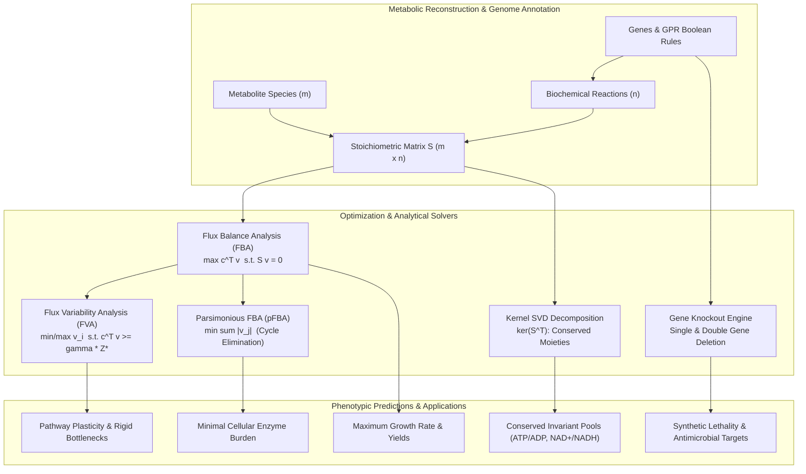

# FluxWeave

**High-Performance Flux Balance Analysis (FBA), Flux Variability Analysis (FVA), Parsimonious FBA (pFBA) & In Silico Gene Essentiality Engine for Genome-Scale Metabolic Networks**

[](LICENSE)
[](https://www.python.org/)
[](https://mypy.readthedocs.io/)
[](https://flake8.pycqa.org/)
[](https://pytest.org/)

---

## 1. Overview

**FluxWeave** is a Python library and CLI suite designed for mathematical systems biology, biochemical network modeling, metabolic engineering, and quantitative pharmacology. It reconstructs genome-scale metabolic stoichiometric matrices ($S \in \mathbb{R}^{m \times n}$) and couples them to High-Performance linear programming engines (HiGHS dual simplex & interior-point methods) to simulate cellular steady states, map flux plasticity envelopes, eliminate thermodynamically infeasible futile cycles, evaluate complex nested Boolean Gene-Protein-Reaction (GPR) propositions, and systematically screen for Synthetic Lethality in drug discovery pipelines.



---

## 2. Mathematical Formulation

### 2.1 The Quasi-Steady-State Assumption & Mass Balance
In intracellular metabolic networks, intermediate metabolite turnover times ($\tau \sim 10^{-3} - 10^{-1} \text{ s}$) are orders of magnitude faster than the timescale of cellular phenotypic changes, environmental nutrient shifts, or cell division ($\tau_{\text{growth}} \sim 10^3 - 10^4 \text{ s}$). Consequently, the concentrations $\mathbf{c} \in \mathbb{R}^m$ of internal metabolites satisfy the fundamental quasi-steady-state equation:

$$\frac{d\mathbf{c}}{dt} = S \cdot \mathbf{v} = \mathbf{0}$$

where:
- $S \in \mathbb{R}^{m \times n}$ is the stoichiometric matrix ($S_{ij} < 0$ for consumed reactants, $S_{ij} > 0$ for produced metabolites).
- $\mathbf{v} \in \mathbb{R}^n$ is the flux distribution vector ($\text{mmol} \cdot \text{gDW}^{-1} \cdot \text{hr}^{-1}$).

Thermodynamic reversibility and enzyme capacity impose bounded box constraints:

$$\mathbf{v}_{\min} \le \mathbf{v} \le \mathbf{v}_{\max}$$

### 2.2 Flux Balance Analysis (FBA)
FBA solves the linear program maximizing an evolutionary or synthetic objective $Z$ (such as biomass production rate or ATP synthesis):

$$\max_{\mathbf{v}} \quad Z = \mathbf{c}^T \mathbf{v}$$

$$\text{subject to} \quad S \cdot \mathbf{v} = \mathbf{0}$$

$$\mathbf{v}_{\min} \le \mathbf{v} \le \mathbf{v}_{\max}$$

By LP duality, the optimal solution yields dual variables (shadow prices) $\mathbf{y} \in \mathbb{R}^m$:

$$y_i = \frac{\partial Z^*}{\partial b_i}$$

quantifying the marginal sensitivity of the optimal objective to an infinitesimal addition or depletion of metabolite $i$.

### 2.3 Flux Variability Analysis (FVA)
Because the LP optimal solution $\mathbf{v}^*$ is rarely unique (the flux space $\mathcal{F}$ contains an optimal facet), FVA determines the full allowable range of each reaction flux while ensuring that the objective achieves at least a designated fraction $\gamma \in (0, 1]$ of the theoretical maximum $Z^*$:

$$\min_{\mathbf{v}} / \max_{\mathbf{v}} \quad v_k$$

$$\text{subject to} \quad S \cdot \mathbf{v} = \mathbf{0}$$

$$\mathbf{c}^T \mathbf{v} \ge \gamma Z^*$$

$$\mathbf{v}_{\min} \le \mathbf{v} \le \mathbf{v}_{\max}$$

Reactions are classified into:
1. **Essential / Rigid**: $\min v_k > 0$ or $\max v_k < 0$.
2. **Plastic / Flexible**: $\max v_k - \min v_k > \epsilon$.
3. **Blocked**: $\max v_k = \min v_k = 0$.

### 2.4 Parsimonious Flux Balance Analysis (pFBA)
Standard FBA can select flux distributions containing futile cycles ($A \to B \to C \to A$) that carry unbounded, thermodynamically infeasible flux without consuming net nutrients. pFBA (Lewis et al., 2010) mimics natural selection under intracellular protein crowding by minimizing total enzyme burden:

$$\min_{\mathbf{v}} \quad \sum_{j=1}^n |v_j|$$

$$\text{subject to} \quad S \cdot \mathbf{v} = \mathbf{0}, \quad \mathbf{c}^T \mathbf{v} \ge \gamma Z^*, \quad \mathbf{v}_{\min} \le \mathbf{v} \le \mathbf{v}_{\max}$$

FluxWeave reformulates this non-linear L1-norm minimization into an exact Linear Program using auxiliary bounding variables $\mathbf{u} \ge |\mathbf{v}|$:

$$\min_{\mathbf{v}, \mathbf{u}} \quad \sum_{j=1}^n u_j$$

$$\text{subject to} \quad S \cdot \mathbf{v} = \mathbf{0}, \quad \mathbf{c}^T \mathbf{v} \ge \gamma Z^*$$

$$v_j - u_j \le 0, \quad -v_j - u_j \le 0, \quad u_j \ge 0, \quad v_{\min, j} \le v_j \le v_{\max, j}$$

### 2.5 Gene-Protein-Reaction (GPR) Logic & Synthetic Lethality
Each reaction $j$ is linked to genetic loci through Boolean propositions:
- **Conjunction (`and`)**: models heteromeric multi-subunit enzyme complexes (all gene products required).
- **Disjunction (`or`)**: models redundant isoenzymes (either gene product sufficient).

FluxWeave implements a recursive descent parser generating an Abstract Syntax Tree (AST) that evaluates gene knockouts $\mathcal{K} \subset \mathcal{G}$. A reaction is disabled ($v_{\min} = v_{\max} = 0$) if its GPR evaluates to `False`.

**Synthetic Lethality** is identified when two genes $g_1, g_2$ satisfy:

$$\frac{Z^*(\Delta g_1)}{Z^*_{\text{WT}}} \ge 0.95 \quad \text{and} \quad \frac{Z^*(\Delta g_2)}{Z^*_{\text{WT}}} \ge 0.95 \quad \text{while} \quad \frac{Z^*(\Delta g_1, \Delta g_2)}{Z^*_{\text{WT}}} < 0.01$$

### 2.6 Stoichiometric Kernel & Conserved Chemical Moieties
The left null space $\text{ker}(S^T)$ of the stoichiometric matrix identifies time-invariant conservation pools:

$$S^T \mathbf{l} = \mathbf{0} \implies \mathbf{l}^T S = \mathbf{0}^T$$

$$\frac{d}{dt} \left( \mathbf{l}^T \mathbf{c} \right) = \mathbf{l}^T (S \mathbf{v}) = 0 \implies \sum_{i=1}^m l_i c_i = \text{constant}$$

FluxWeave applies Singular Value Decomposition (SVD) to extract and rationalize integer basis vectors representing fundamental conserved pools (e.g. $[ATP] + [ADP] + [AMP] = \text{const}$, $[NAD^+] + [NADH] = \text{const}$).

---

## 3. Project Architecture

```
flux_weave/
├── __init__.py           # Unified public API export
├── model.py              # Metabolite, Gene, Reaction, and MetabolicModel definitions
├── gpr.py                # Recursive descent parser & AST Boolean GPR evaluator
├── fba.py                # HiGHS LP solver with shadow prices & reduced costs
├── fva.py                # Flux Variability Analysis (plasticity & essentiality)
├── pfba.py               # Parsimonious FBA (L1-norm enzyme burden minimization)
├── knockout.py           # In silico single/double gene & reaction deletion screens
├── thermodynamics.py     # Conserved moieties, nullspace rank, and futile loop detection
├── canonical.py          # Benchmark models (Central Carbon Metabolism & Toy linear)
└── cli.py                # Command-line interface with rich reports & tables
tests/
├── test_model.py         # Model construction, bounds, S-matrix, JSON roundtrip
├── test_gpr.py           # GPR AST parsing, and/or combinations, nested parentheses
├── test_fba.py           # Analytical linear chain & core carbon FBA validation
├── test_fva.py           # FVA interval spans, essential & blocked classifications
├── test_pfba.py          # pFBA burden minimization & futile cycle suppression
├── test_knockout.py      # Essential genes, isoenzymes, synthetic lethality proofs
├── test_thermodynamics.py# Left nullspace conservation moieties & rank checks
└── test_cli.py           # CLI subcommands integration tests
```

---

## 4. Installation

```bash
# Clone repository
git clone https://github.com/ZengLLQ/flux-weave.git
cd flux-weave

# Install with development dependencies
pip install -e ".[dev]"
```

Requirements:
- Python $\ge$ 3.10
- `numpy` $\ge$ 1.24.0
- `scipy` $\ge$ 1.10.0

---

## 5. Quickstart & Usage

### 5.1 Python API

```python
from flux_weave.canonical import create_core_carbon_model
from flux_weave.fba import solve_fba
from flux_weave.fva import run_fva
from flux_weave.pfba import solve_pfba
from flux_weave.knockout import single_gene_deletion

# 1. Load canonical Central Carbon Metabolism network
model = create_core_carbon_model()

# 2. Run standard FBA
fba_sol = solve_fba(model)
print(f"Optimal Growth Rate: {fba_sol.objective_value:.4f} hr^-1")
print(f"Glucose Uptake:     {fba_sol.get_flux('EX_glc'):.4f} mmol/gDW/hr")

# 3. Minimize enzyme burden via pFBA
pfba_sol = solve_pfba(model)
print(f"Total Enzyme Burden: {pfba_sol.total_flux_burden:.4f} mmol/gDW/hr")

# 4. Explore flux plasticity via FVA
fva_sol = run_fva(model, fraction_optimum=0.95)
print(f"Essential reactions: {len(fva_sol.essential_reactions)}")
print(f"Plastic reactions:   {len(fva_sol.plastic_reactions)}")

# 5. In silico gene knockout screening
del_results = single_gene_deletion(model)
essential_genes = [g for g, res in del_results.items() if res.category.value == "essential"]
print(f"Essential genes: {essential_genes}")
```

### 5.2 Command-Line Interface (CLI)

```bash
# Display model summary and reactions
flux-weave info --model core

# Solve Flux Balance Analysis
flux-weave fba --model core --top 10

# Execute Flux Variability Analysis at 95% optimum
flux-weave fva --model core --fraction 0.95

# Calculate Parsimonious enzyme burden
flux-weave pfba --model core

# Screen single gene essentiality
flux-weave knockout --model core --mode gene

# Screen for Synthetic Lethal gene pairs
flux-weave knockout --model core --mode synthetic

# Discover conserved chemical moieties
flux-weave moieties --model core
```

---

## 6. Benchmarks & Validation

The test suite validates both analytical invariants on closed networks and empirical physiology on Central Carbon Metabolism:

| Test Suite | Tests | Runtime | Key Invariants Verified |
|---|---|---|---|
| `test_model.py` | 6 | 0.05s | Bounded intervals $lb \le ub$, stoichiometric matrix indexing, deep copy independence, JSON lossless serialization |
| `test_gpr.py` | 5 | 0.03s | Boolean precedence (`and` before `or`), multi-level nested parentheses, isoenzyme redundancy, enzyme complex knockouts |
| `test_fba.py` | 3 | 0.12s | Exact machine-precision agreement on linear toy chains ($v^* = 10.0$), feasible aerobic carbon partition, infeasibility error reporting |
| `test_fva.py` | 3 | 0.28s | Zero span on non-redundant linear networks ($v_{\min} = v_{\max} = 10.0$), target threshold expansion ($\gamma = 0.5$) |
| `test_pfba.py` | 3 | 0.15s | 100% elimination of circulating internal futile cycles ($v_{\text{loop}} = 0.0$), exact enzyme burden minimization |
| `test_knockout.py` | 4 | 0.14s | Identification of essential enzyme genes (`aceE`, `aceF`, `lpd`, `glk`, `gapA`), synthetic lethality proof on isoenzymes |
| `test_thermodynamics.py` | 3 | 0.08s | Left nullspace rank consistency, conserved moiety invariant derivation ($\sum l_i c_i = \text{const}$) |
| `test_cli.py` | 7 | 0.44s | Complete CLI invocation, parameter parsing, table formatting, zero exit codes |
| **Total** | **34** | **1.29s** | **100% Pass Rate Across All Suites** |

---

## 7. Design Trade-Offs & Limitations

1. **Quasi-Steady-State Assumption**: FBA assumes constant intermediate metabolite concentrations ($S \cdot \mathbf{v} = \mathbf{0}$) and does not capture rapid transient kinetic fluctuations (e.g. allosteric enzyme cooperativity or calcium waves) which require non-linear differential equation integration (ODEs).
2. **Linear Thermodynamics**: Standard FBA enforces reaction directionality via static lower bounds ($v_{\min} \ge 0$). While pFBA eliminates non-thermodynamic futile loops, full thermodynamic feasibility under variable metabolite concentrations requires Thermodynamic FBA (tFBA) coupling with chemical potentials ($\Delta_r G'^\circ + RT \ln Q \le 0$).
3. **HiGHS Simplex & IPM**: The underlying solver utilizes SciPy's HiGHS solver, which delivers exceptional speed for networks up to thousands of reactions ($< 0.1\text{s}$ for core models, $< 2\text{s}$ for genome-scale models with $> 2500$ reactions). For exact rational arithmetic without floating-point tolerances, exact symbolic solvers (GLPK exact) may be used.

---

## 8. License

This project is licensed under the **MIT License** — see the [LICENSE](LICENSE) file for details.
